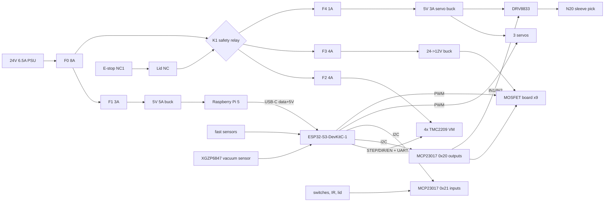

# Card scanner / sleever / sorter – wiring

The machine has two brains on one USB cable:

- **Raspberry Pi 5** (host): cameras, recognition, UI. Powered from its own 5 V 5 A buck.
- **ESP32-S3-DevKitC-1** (motion controller):
  - 4x TMC2209 + steppers
  - 3 servos
  - 9 MOSFET channels: vacuum pump, air pump, 5 valves, 2 light rings
  - 1 DRV8833 channel: the N20 `sleeve_pick` gearmotor
  - every sensor

  It is powered from the Pi over the USB cable that also carries the protocol.

Firmware and pin constants: [`../firmware/include/config.h`](../firmware/include/config.h).
Host protocol: [`../firmware/PROTOCOL.md`](../firmware/PROTOCOL.md). Diagram:
[`wiring.svg`](wiring.svg) (`python3 wiring.py` regenerates it).

```
 AC ─ IEC inlet (fuse, switch) ─ 24 V 6.5 A PSU
                                   │
                        F0 8 A ────┼──────────────────────────────── 24V_ALWAYS
                                   │                                    │
                                   │                               F1 3 A ─ 5 V 5 A buck ─► Pi 5 ─USB─► ESP32-S3
                                   │
   E-STOP NC1 ─ LID NC ─ K1 coil ──┘ (K1 = safety relay, 24 V coil)
                                   │ K1 contacts
                                   ▼
                               24V_SW ──┬─ F2 4 A ─► TMC2209 VM x4 ─► elevator / pick / feed / tongue steppers
                                        ├─ F3 4 A ─► 24→12 V 8 A buck ─ 12V_SW ─► MOSFET board: pumps, valves, LED rings
                                        └─ F4 1 A ─► 5 V 3 A buck ─ 5V_SERVO ─► lift / pusher / diverter servos, DRV8833 VM (N20 sleeve pick)
```



## ESP32-S3-DevKitC-1 pins

The board must be a 3.3 V-flash variant: N8, N8R8 or N16R8. On "R8V" / 1.8 V-flash boards,
GPIO47 runs at 1.8 V.

These pins are **not used**:
- strapping pins 0 / 3 / 45 / 46
- USB 19 / 20: the host link
- UART0 43 / 44: the "UART" USB port
- flash / PSRAM 26–37
- the RGB LED: 38 on v1.1 boards, 48 on v1.0

That leaves 23 usable GPIOs, and all of them are used. Slow I/O goes through two MCP23017s.

| GPIO | Signal | Goes to | Notes |
|---|---|---|---|
| 1 | `VAC_SENSE` | XGZP6847 `Vout` via divider | 10 kΩ series, 20 kΩ to GND. ADC1_CH0. 100 nF at the pin |
| 2 | `DOUBLE_FEED` | Slot-opto module `DO` | Opto across the thickness-gauge flag. HIGH = 2+ cards |
| 4 | `ELEV_STEP` | TMC2209 #0 `STEP` | Elevator |
| 5 | `ELEV_DIR` | TMC2209 #0 `DIR` | |
| 6 | `PICK_STEP` | TMC2209 #1 `STEP` | Pick arm |
| 7 | `PICK_DIR` | TMC2209 #1 `DIR` | |
| 8 | `STEPPER_EN` | `EN` of all four TMC2209 | Active LOW. **10 kΩ pull-up to 3V3** so the drivers are off during reset/flash |
| 9 | `TMC_TX` | 1 kΩ → `PDN_UART` bus | UART1 TX |
| 10 | `TMC_RX` | `PDN_UART` bus | UART1 RX. One wire to all four drivers |
| 11 | `I2C_SDA` | Both MCP23017 `SDA` | 4.7 kΩ pull-up to 3V3 (one set for the bus) |
| 12 | `I2C_SCL` | Both MCP23017 `SCL` | 4.7 kΩ pull-up to 3V3 |
| 13 | `SERVO_LIFT` | Lift servo signal (orange) | LEDC 50 Hz |
| 14 | `SERVO_PUSHER` | Pusher servo signal | |
| 15 | `FEED_STEP` | TMC2209 #2 `STEP` | Feed rollers |
| 16 | `FEED_DIR` | TMC2209 #2 `DIR` | |
| 17 | `TONGUE_STEP` | TMC2209 #3 `STEP` | Tongue |
| 18 | `TONGUE_DIR` | TMC2209 #3 `DIR` | |
| 21 | `SERVO_DIVERTER` | Diverter servo signal | |
| 39 | `LIGHT_TOP` | MOSFET Q8 gate | LEDC 20 kHz PWM |
| 40 | `LIGHT_BOTTOM` | MOSFET Q9 gate | |
| 41 | `SCAN_STOP` | Microswitch `NO` → GND | `INPUT_PULLUP`. Pressed = card at the scan station |
| 42 | `SLEEVE_MOUTH` | TCRT5000 module `DO`, under the platen (Ø2.5 window at S (6, −26)) | `INPUT_PULLUP`. LOW = card seen |
| 47 | `ESTOP` | E-stop contact **NC2** → GND | `INPUT_PULLUP`. Open (HIGH) = pressed or wire cut |
| 3V3 | 3.3 V logic | MCP23017s, sensors, TMC2209 `VIO`, pull-ups | About 300 mA total. The DevKit LDO is fine |
| 5V | (from USB) | Nothing | The board is powered by the Pi's USB. Leave 5V unconnected |
| GND | Logic ground | Every module, and one wire to the star point | See Grounding |

### MCP23017 #1, address 0x20 (`A2 A1 A0` = GND GND GND): outputs

| Pin | Signal | Load (MOSFET) |
|---|---|---|
| GPA0 | `VAC_PUMP` | Q1: 12 V vacuum pump |
| GPA1 | `PICK_CUP` | Q2: NC valve, pick-arm cup |
| GPA2 | `PLATEN` | Q3: NC valve, sleeve platen |
| GPA3 | `LIFT_CUP` | Q4: NC valve, lift cup |
| GPA4 | `PUFF_PUMP` | Q5: 12 V air pump |
| GPA5 | `STACK_PUFF` | Q6: NC valve, hopper air knife |
| GPA6 | `MOUTH_JET` | Q7: NC valve, sleeve-mouth jet |
| GPA7 | `SLEEVE_PICK_IN1` | DRV8833 `AIN1` (N20 sleeve pick) |
| GPB0 | `SLEEVE_PICK_IN2` | DRV8833 `AIN2` |
| GPB1–7 | spare | Beacon, buzzer, more valves |

`sleeve_pick` runs from two expander outputs because every ESP32 GPIO is taken. It needs no PWM:
the pick is a fixed-speed run until `sleeve_present` trips (max `sleeve_pick_ms`), and the speed
is set by the gear ratio and the 5 V supply. IN1/IN2: 1/0 = forward (sleeve out of the magazine),
1/1 = brake (the firmware's "off"), 0/0 = coast (power-up: the pins are high-Z and the DRV8833
input pull-downs hold them low). The second pin buys the brake, so the wheels stop dead and do not
drag the next sleeve into the gate. It also leaves reverse (0/1) open for later.

`RESET` → 3V3 (10 kΩ). `VDD` 3V3, `VSS` GND, 100 nF across them.

At power-up the pins are inputs (high-Z). The 10 kΩ gate pull-downs keep every load off until
the firmware drives them.

### MCP23017 #2, address 0x21 (`A0` = 3V3): inputs

The firmware enables the internal pull-ups (~100 kΩ). For runs over ~30 cm, add a 4.7 kΩ
pull-up to 3V3 and 100 nF to GND at the expander.

On current MCP23017 silicon, GPA7/GPB7 are **output-only**. They are left unused (driven low).

| Pin | Signal | Sensor | Active |
|---|---|---|---|
| GPA0 | `STACK_TOP` | TCRT5000 IR reflective module `DO`, above the hopper | LOW = card seen |
| GPA1 | `EXIT` | TCRT5000 module `DO` in the diverter_base lead-in | LOW = card seen |
| GPA2 | `ELEV_HOME` | Microswitch, **NC** → GND, bottom of travel | HIGH = pressed / wire cut |
| GPA3 | `ELEV_LIMIT` | Microswitch, NC → GND, top of travel | HIGH |
| GPA4 | `PICK_HOME` | Microswitch, NC → GND, pick arm retracted | HIGH |
| GPA5 | `TONGUE_HOME` | Microswitch, NC → GND, tongue retracted | HIGH |
| GPA6 | `LID` | Lid switch, NC (closed while the lid is shut) → GND | HIGH = open |
| GPB0 | `MAG_LOW` | TCRT5000 at the magazine "low" mark | HIGH = no sleeve seen |
| GPB1 | `MAG_EMPTY` | TCRT5000 at the magazine bottom | HIGH = no sleeve seen |
| GPB2 | `SLEEVE_PRESENT` | TCRT5000 module `DO`, under the platen (Ø2.5 window at S (30, −30), 1.5–3.4 mm short of the fence) | LOW = sleeve seen |
| GPB3–6 | spare inputs | | |

Endstops are wired **normally closed**, so a broken wire reads as "at the switch". A homing
move then fails (`jam`) instead of crashing the axis. Polarities are set in `config.h`
(`ACTIVE_*`).

### TMC2209 modules (BTT / FYSETC style, R_sense 0.11 Ω)

| Pin | Connect |
|---|---|
| `VM` / `GND` (power) | 24V_SW after F2, with **100 µF 35 V low-ESR** at each module. Power GND straight to the star point |
| `VIO` / `GND` (logic) | 3V3 / logic GND |
| `EN` | `STEPPER_EN` (GPIO8), shared |
| `STEP`, `DIR` | see the pin table |
| `PDN_UART` (sometimes `PDN`, `UART`, `RX`) | Shared bus: GPIO10 directly, GPIO9 through 1 kΩ. Some modules need a solder bridge to bring UART out to the pin |
| `MS1` / `MS2` | UART address: #0 elevator L/L, #1 pick H/L, #2 feed L/H, #3 tongue H/H (H = 3V3, L = GND) |
| `A1 A2 B1 B2` | Motor coils. Never connect or disconnect with VM on |
| `DIAG`, `INDEX`, `CLK`, `SPREAD` | Leave open. StallGuard is read over UART if needed |

On the UART bus the firmware sets:
- 16 microsteps, StealthChop
- `I_scale_analog = 0`, so the current comes from the register (`cur_*` settings), not
  from Vref
- hold current at 50 %

**Set Vref anyway** (table below). It is the fallback current if the UART bus is dead,
because a TMC2209 that never got configured runs from Vref at full IRUN.

### Servos

| Servo | Signal | Power |
|---|---|---|
| Lift (MG90S) | GPIO13 | 5V_SERVO / GND |
| Pusher (MG90S, or MG996R if the push is stiff) | GPIO14 | 5V_SERVO / GND |
| Diverter (MG90S) | GPIO21 | 5V_SERVO / GND |

The 3.3 V signal drives MG90S/SG90 reliably. Put **470 µF** across 5V_SERVO at the servo
headers. Join the servo GND to logic GND at the ESP32 header, so the signal has a reference.

### Sleeve pick motor: DRV8833

An N20 6 V gearmotor (~300 rpm) drives two Ø20 rubber wheels, linked by a 2 mm O-ring: wheel A
in the magazine floor, wheel B in the platen. They push the **bottom** sleeve out of the side
magazine, through the 0.14 mm gate (1.5 × one 0.09 mm sleeve), onto the platen against the fence. The
wheels keep running `sleeve_push_ms` after `sleeve_present` trips, so the sleeve ends flush on the fence.

| DRV8833 pin | Connect |
|---|---|
| `VM` / `GND` | 5V_SERVO / GND, 10 µF at the module. The N20 runs at ~5/6 speed on 5 V. 5V_SERVO is cut by K1, so an e-stop or open lid stops the motor even if the expander hangs |
| `AIN1` / `AIN2` | MCP #1 GPA7 / GPB0 |
| `AOUT1` / `AOUT2` | N20 motor. Swap the wires if it runs backwards (pulls the sleeve into the magazine) |
| `nSLEEP` (`STBY`/`EEP` on some boards) | 3V3 (many modules pull it up to VM already) |
| `nFAULT` | Leave open |
| `BIN1` / `BIN2`, `BOUT1` / `BOUT2` | Unused, tie BIN1/BIN2 to GND |

The N20 draws ~0.1 A running and ~0.5 A stalled (wheels slipping on a sleeve at the fence).
The DRV8833 limits nothing by itself: keep `sleeve_pick_ms` short.

### Pneumatics and lights: 9-channel MOSFET board (perfboard or 2× 4-ch + 1)

Each channel:
```
 12V_SW ──┬──────────────┐
          │             LOAD (valve / pump / LED ring)
     SS34 ▲ (flyback,   │
          │  cathode    │
          └── to +12) ──┤ drain
                        Q  IRLB8721PbF (TO-220) or AO3400A (SOT-23)
 MCP pin / GPIO ─ 100 Ω ─┤ gate
                        ├── 10 kΩ ── GND
                        │ source
                       PGND (to the 12 V buck's minus terminal, not via the ESP)
```

| Q | Load | Typical current | Notes |
|---|---|---|---|
| Q1 | 12 V vacuum pump (diaphragm, ≥ 60 kPa) | 0.4–0.8 A, 2 A start | Flyback diode. Add 220 µF at the pump if the 12 V dips |
| Q2–Q4 | 12 V NC **3/2-way** solenoid valves: pick cup, platen, lift cup | 0.15–0.3 A each | Flyback on each. De-energised the cup port must vent to air, or the cup keeps its vacuum and never lets go |
| Q5 | 12 V air pump | 0.3–0.6 A | Flyback |
| Q6–Q7 | 12 V NC valves: stack puff, mouth jet | 0.15–0.3 A | Flyback |
| Q8–Q9 | 12 V white LED strip (non-addressable), ~0.45 m in each LED frame, top / bottom | 0.3–0.5 A each | PWM 20 kHz. The LED-frame diffuser evens the light |

**Air path (CAD):** one air pump feeds a tee to the hopper puff nozzle (hopper_front) and the
sleeve-mouth jet (air_jet). Both branches need their own NC valve **downstream of the pump**:
`STACK_PUFF` (Q6) on the hopper branch, `MOUTH_JET` (Q7) on the mouth branch. The firmware opens
only one at a time with the pump. The CAD BOM lists 3 valves (vacuum side only). Buy 5.

470 µF 25 V across 12V_SW at the board input.

### Sensors

| Sensor | Part | Power | Output |
|---|---|---|---|
| `stack_top` | TCRT5000 module (LM393), 2–5 mm above the top card | 3V3 | `DO`, LOW = reflect |
| `double_feed` | Slot opto module (ITR9608 / H206) + spring flag. The flag rides on the card at 1.5× card thickness and lifts into the slot only with 2+ cards | 3V3 | `DO`, HIGH = blocked. Set `ACTIVE_DOUBLE_FEED` to match your module |
| `scan_stop` | KW-mini microswitch on stop_mount, actuated by stop_flag (Ø1.8 pin) | — | NO → GND |
| `sleeve_mouth` | TCRT5000 module (LM393), under the platen, looking up through the Ø2.5 window at S (6, −26) | 3V3 | `DO`, LOW = reflect. An empty sleeve covers the window: set the pot so a clear sleeve reads HIGH and a card in it reads LOW |
| `sleeve_present` | TCRT5000 module (LM393), under the platen, looking up through the Ø2.5 window at S (30, −30), next to the fence | 3V3 | `DO`, LOW = reflect. Set the pot so an empty sleeve reads LOW and the bare platen window reads HIGH |
| `exit` | TCRT5000 module, Ø2.5 window in the diverter_base lead-in | 3V3 | `DO`, LOW = card seen |
| Elevator, pick, tongue endstops | Microswitch (KW11-3Z / D2F) | — | **NC** → GND |
| `mag_low`, `mag_empty` | TCRT5000 module looking at the sleeve stack | 3V3 | HIGH = no sleeve |
| Vacuum | XGZP6847A, −100…0 kPa, 5 V, 0.5–4.5 V out (part number ending `KPGN`) | 5 V from the Pi 5 V rail (or a 3.3→5 V boost), plus 100 nF | 4.5 V = ambient, 0.5 V = −100 kPa. 10 k/20 k divider → 0.33–3.0 V at GPIO1 |

Power every sensor module from **3V3**, so its output never exceeds the ESP32's 3.3 V. The
vacuum sensor is the exception: it needs 5 V, and the divider brings its output down.

Tee the vacuum sensor into the **vacuum manifold** between the pump and the three cup valves.
- With every open cup sealed, the manifold holds about 60 kPa.
- An open cup that is not sealed drops it to a few kPa. That is how the firmware detects
  grip (`vac_grip_kpa`).

### E-stop and lid (hardware first)

- **E-stop**: twist-release mushroom with **two NC contact blocks**.
  - **NC1** is in series with the lid switch and the coil of **K1**. K1 is a 24 V safety
    relay, or a DC power relay with contacts rated ≥ 10 A at 30 V DC.
  - K1's contacts feed **24V_SW**: TMC2209 VM, the 12 V buck and the servo buck.
  - **NC2** goes to GPIO47 so the firmware knows: it disables the drivers, stops the
    sequence and emits `estop`.
  - Put a 1N4007 across K1's coil.
- **Lid**: a safety interlock switch, or two microswitches.
  - One NC contact goes in the K1 coil chain.
  - The other NC contact goes to MCP #2 GPA6 (`lid_open` event).
- The Pi and the ESP32 stay powered (24V_ALWAYS), so the host can report the stop. Motion
  resumes only after the operator releases the stop and the host sends `reset` and `home`.
  To meet stricter rules, add a latching START button in the K1 coil circuit, so power never
  comes back on its own.

## Power tree

| Rail | Source | Feeds | Peak | Notes |
|---|---|---|---|---|
| 24V_ALWAYS | Mean Well LRS-150-24 (24 V 6.5 A) via F0 | Pi buck, K1 coil | | AC side: IEC inlet with a 2 A slow fuse and switch |
| 5V_PI | 24→5 V 5 A buck (e.g. Pololu D36V50F5, or a 5 V 5 A "mini560 pro") via F1 | Pi 5 (GPIO 5V pins or a USB-C pigtail), vacuum sensor | 5 A | Set it to 5.1 V. Without USB-PD, tell the Pi it has 5 A: `PSU_MAX_CURRENT=5000` (`sudo rpi-eeprom-config -e`) |
| 3V3 | ESP32 DevKit LDO, from the Pi's USB 5 V | ESP32, MCP23017 ×2, TMC VIO, sensors | ~0.3 A | |
| 24V_SW | K1 contacts | TMC2209 VM ×4 (F2), 12 V buck (F3), servo buck (F4) | | Cut by the e-stop or lid |
| 12V_SW | 24→12 V 8 A buck (XL4016 module or Mean Well DDR-60G-12) via F3 | MOSFET board: pumps, valves, LED rings | ~3.5 A | |
| 5V_SERVO | 24→5 V 3 A buck (Pololu D36V28F5 or LM2596 module) via F4 | 3 servos, DRV8833 / N20 | 2.6 A stall | Separate from 5V_PI, so servo spikes never brown out the Pi |

Budget at 24 V:

| Load | Typical | Peak |
|---|---|---|
| Steppers | 1.0 A | 2.0 A |
| 12 V branch | 0.8 A | 2.0 A |
| Pi | 0.6 A | 1.2 A |
| Servos + N20 | 0.2 A | 0.6 A |
| **Total** | **≈ 2.6 A** | **≈ 5.7 A** |

LRS-150-24 (6.5 A) covers it.

## Fusing

| Fuse | Where | Rating | Protects |
|---|---|---|---|
| — | AC inlet | 2 A slow (5×20) | PSU, mains wiring |
| F0 | PSU +V out | 8 A ATO blade | Main 24 V harness (16 AWG) |
| F1 | Pi buck input | 3 A | Pi branch |
| F2 | TMC VM bus | 4 A | Drivers / motor wiring (18 AWG) |
| F3 | 12 V buck input | 4 A | 12 V branch. Add a 5 A fuse on the buck output if its wiring is thin |
| F4 | Servo buck input | 1 A | Servo branch |

Use an inline ATO/mini-blade holder per branch, or a small 6-way blade fuse box on 24 V.

## Grounding

- **One star point**: the PSU −V terminal, or a ground bus bar right next to it. Run
  separate returns to it from:
  - each TMC2209 power GND
  - the 12 V buck minus, which carries the MOSFET source returns
  - the servo buck minus
  - the Pi buck minus
- **Logic ground** (ESP32, MCPs, sensors, TMC logic GND) joins the star with one wire. The
  USB cable also ties the ESP32 GND to the Pi GND. The Pi's buck shares the star, so this
  loop is small. Keep the USB cable short (≤ 0.5 m), and route it away from the motor wires.
- Motor, pump and valve currents must **never** return through the ESP32, the USB cable or
  the sensor wiring:
  - MOSFET sources go to the 12 V buck minus (PGND), not to the ESP header.
  - The MOSFET board gets one thin logic-GND wire from the ESP for the gate reference.
- Twist each stepper's coil pairs. Run motor cables apart from the sensor and I2C wiring.
  Keep the I2C wiring under 30 cm, or slow `I2C_HZ` to 100 kHz.
- If the frame is metal, bond it to mains PE at the PSU. Do not tie DC ground to PE in more
  than that one place.

## TMC2209 current / Vref

For modules with R_sense = 0.11 Ω: **I_rms ≈ 0.71 × Vref**, so **Vref ≈ 1.41 × I_rms**.
Measure Vref between the pot wiper (or the `VREF` pad) and GND with VIO powered.

| Axis | Motor (example) | Rated (phase, peak) | Run I_rms (`cur_*` default) | Vref | Hold |
|---|---|---|---|---|---|
| Elevator | NEMA17 17HS4401, 42×40 mm, T8×8 leadscrew | 1.7 A | 0.80 A | 1.13 V | 0.40 A |
| Pick | NEMA17 17HS3401, 42×34 mm, GT2 20T | 1.3 A | 0.60 A | 0.85 V | 0.30 A |
| Feed | NEMA17 17HS3401, 42×34 mm, O-ring rollers | 1.3 A | 0.60 A | 0.85 V | 0.30 A |
| Tongue | NEMA17 pancake 17HS08-1004S, 42×20 mm (or NEMA14), GT2 20T | 1.0 A | 0.50 A | 0.71 V | 0.25 A |

- Start at these values. Raise `cur_*` in 100 mA steps only if an axis skips. A TMC2209
  module tops out around 1.4 A RMS without extra cooling.
- Without a heatsink and airflow, stay ≤ 1.0 A RMS.
- The T8 lead-8 screw is **not** self-locking (lead angle 18.6° > friction angle ~11°), but a full
  stack back-drives it with only ~2.4 mN·m, below the motor's detent torque, so its hold current
  can be low.

Steps per mm (`config.h`, 16 µsteps):

| Axis | Steps per mm |
|---|---|
| Elevator, T8 lead 8 | 400 |
| Pick / tongue, GT2 20T | 80 |
| Feed (28 mm roller: D26 hub + 2 mm O-ring) | 36.4. Calibrate it |

## BOM (electronics)

| Qty | Part | Example | Notes |
|---|---|---|---|
| 1 | Raspberry Pi 5 (4/8 GB) + active cooler | | Host |
| 1 | ESP32-S3-DevKitC-1 N8R8 | Espressif / clone | 3.3 V flash variant |
| 4 | TMC2209 stepper driver module | BTT TMC2209 V1.3, FYSETC | UART mode |
| 3 | NEMA17 stepper 1.3–1.7 A | 17HS4401 (elevator), 17HS3401 ×2 | |
| 1 | NEMA17 pancake or NEMA14 | 17HS08-1004S | Tongue |
| 1 | T8 leadscrew 8 mm lead + brass nut + coupler | | Elevator |
| 3 | MG90S metal-gear micro servo | TowerPro MG90S | Lift, pusher, diverter (MG996R for a heavy pusher) |
| 1 | N20 6 V gearmotor, ~300 rpm, 3 mm D shaft | GA12-N20 300 rpm | `sleeve_pick`, plus 2 Ø 20 mm rubber wheels and a 2 mm O-ring belt |
| 1 | DRV8833 dual H-bridge module | Pololu 2130 / generic red DRV8833 board | `sleeve_pick` (channel A) |
| 2 | MCP23017 I/O expander | DIP-28, or a CJMCU-2317 module | 0x20 out, 0x21 in |
| 9 | Logic-level N-MOSFET | IRLB8721PbF (TO-220) or AO3400A | With 100 Ω gate and 10 kΩ pull-down resistors |
| 7 | Schottky flyback diode | SS34 / 1N5819 | Valves + pumps |
| 1 | 12 V vacuum pump, ≥ 60 kPa | Kamoer KVP04 / generic 370 diaphragm pump | |
| 1 | 12 V mini air pump | 370-type air pump | Puffs + jet |
| 3 | 12 V NC 3/2-way mini solenoid valve | "DC 12 V 0520 3-way NC" class | Vacuum: pick cup, platen, lift cup. Common → cup, NC → manifold, NO → air (vents the cup on release) |
| 2 | 12 V NC 2-way mini solenoid valve | "DC 12 V 0520E NC" | Air: stack puff, mouth jet |
| 3 | Vacuum suction cup 6–10 mm | Bellows cup, nitrile/silicone | Pick, lift. Platen: drilled plate |
| 1 | Vacuum pressure sensor | CFSensor XGZP6847A100KPGN | 5 V, 0.5–4.5 V |
| 2 × 0.45 m | 12 V white LED strip, non-addressable (5000–6500 K) | 2835, 60 LED/m | Top / bottom scan light, in the LED-frame channels |
| 6 | TCRT5000 IR reflective module | | `stack_top`, `sleeve_mouth`, `sleeve_present`, `exit`, `mag_low`, `mag_empty` |
| 1 | Slot optical module | ITR9608 / H206 | Double-feed flag |
| 3 | Microswitch, roller lever | Omron D2F-01L / KW11-3Z | Elevator home, pick home, tongue home (NC) |
| 1 | KW-mini microswitch | KW10 / KW4-3Z | `scan_stop` (NO), on stop_mount |
| 2 | Microswitch | Omron D2F-01 | Elevator top limit (NC), spare |
| 1 | Lid interlock switch, 2 NC contacts | Omron D4NS, or 2 microswitches | |
| 1 | E-stop mushroom, 2 NC blocks | 22 mm twist-release | |
| 1 | Relay, 24 V coil, ≥ 10 A 30 V DC contacts | Omron G7L-1A-TUB or a 24 V automotive relay | K1 |
| 1 | 24 V 6.5 A PSU | Mean Well LRS-150-24 | |
| 1 | 24→5 V 5 A buck | Pololu D36V50F5 | Pi |
| 1 | 24→12 V 8 A buck | XL4016 module / Mean Well DDR-60G-12 | Pneumatics + lights |
| 1 | 24→5 V 3 A buck | Pololu D36V28F5 / LM2596 module | Servos |
| 1 | IEC C14 inlet with fuse + switch | | Mains |
| 6 | Blade fuse holder + fuses | 8 / 3 / 4 / 4 / 1 A | |
| 4 | 100 µF 35 V low-ESR electrolytic | | TMC VM |
| 2 | 470 µF 25 V electrolytic | | 12 V board, servo rail |
| — | Resistors | 1 k (UART), 10 k (EN pull-up, gate pull-downs), 4.7 k (I2C, input pull-ups), 20 k (divider) | |
| 1 | USB-C ↔ USB-A cable, short | ≤ 0.5 m | Pi ↔ ESP32 "USB" port |
| — | 4 mm PU tubing, barbed tees, small manifold block | | Vacuum + air |
| — | Wire: 16 AWG (24 V main), 18 AWG (VM, 12 V loads), 22–24 AWG (signals), JST-XH / Dupont | | |
