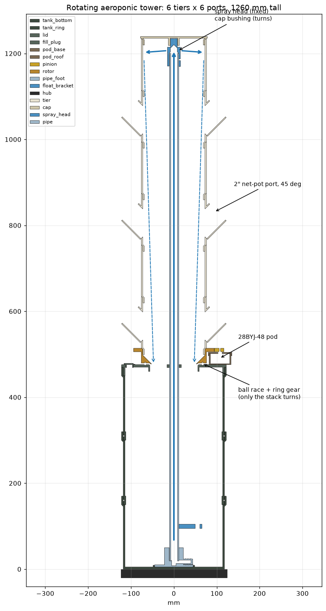

# Rotating outdoor aeroponic grow tower

This is a 3D-printable tower that holds 36 plants and turns slowly, so every side gets the same sun. It is 1.26 m tall, the tank holds about 18 L, and every part fits a 256 × 256 bed. Print it in ASA.



## Based on commercial systems
- **Tower Garden / Agrotonomy** (vertical aeroponics): a pump in the base tank pushes nutrient water up a centre pipe to the top. The water runs down inside the stacked tiers, over the roots, and back into the tank. The plastic is opaque so algae can't grow, and the plants sit in 2" net pots in angled ports.
- **Enova rotating tower**: 6 pots per tier, a 12 W pump with 2.4 m head, and a slow rotation for even light.
- **ZipGrow carousels**: these turn the plants, not the plumbing.

## How it works
- The **tank, pipe and spray head stay still.** Only the tier stack turns. It sits on a **rotor** that runs on 6 mm balls in V-grooves in the lid and the rotor.
- Water falls through the open rotor into the lid drain, so there is **no rotating water seal**.
- The rotor is kept centred by the V-grooves. At the top, the cap's bushing rides on the spray head's stub, which keeps the stack upright in wind.
- A **28BYJ-48 12 V stepper** in a drip-proof pod on the lid drives the rotor's 128T ring gear through a 15T pinion. One tower revolution is 34,953 half-steps, which takes about 70 s at the firmware maximum of 500 half-steps/s. The default is 15° moves adding up to 1 revolution per hour during the day.
- An **ESP32** runs the pump cycle, the rotation, the low-water cut-off and a web UI. See [`firmware/`](firmware/README.md).

## Parts (`cad/stl/`, already in print orientation)
| STL | Qty | Orientation | Notes |
|---|---|---|---|
| tank_bottom | 1 | floor down | floor, wall, collar, pipe-foot locating ring |
| tank_ring | 2 | spigot down | O-ring groove on the spigot |
| lid | 1 | top face down | ball groove, drain + spokes, pipe collar, fill port, PG7 gland hole |
| fill_plug | 1 | cap down | push-in plug |
| rotor | 1 | gear face down | ball groove, 128T m1.5 ring gear, tier socket, drip lip |
| tier | 6 | spigot down | 6 × 2" net-pot ports at 45°; stack each tier 30° turned from the one below |
| cap | 1 | top face down | bushing on the spray stub |
| spray_head | 1 | sleeve down | slides on the pipe, 8 × 2.2 mm jets, Ø16 stub |
| pipe_foot | 1 | base down | pipe socket + 1/2" hose barb |
| float_bracket | 1 | flat | clamps on the pipe, M10 float switch |
| pod_base | 1 | floor down | motor pod, cable notch, drain hole |
| pod_roof | 1 | top face down | the 28BYJ-48 hangs from it; countersunk screws |
| pinion | 1 | flat | 15T m1.5, double-D bore, press fit |
| hub | 1 | top face down | stand centre |
| leg | 4 | on its side | printed diagonally on the bed; 670 mm footprint; tent-stake hole |

The `cad/preview/` folder has assembled-position copies. Open them in `cad/viewer.html` to see the cross-section, an exploded view and the rotation. Serve the folder over HTTP, e.g. `python3 -m http.server` in `cad/`.

## Print settings (ASA, enclosed printer)
- 0.2 mm layers, 4 walls, 5 top/bottom layers, 15–20 % gyroid infill. Turn part cooling off or set it low.
- **Tank parts and lid: make the walls solid.** Set wall loops so the 4 mm wall prints solid (about 9 loops at 0.45 mm). The tank must not leak.
- Use a dark, opaque filament for everything that holds water or roots. Light gets through thin, pale ASA and feeds algae.
- Tall tiers: a 5 mm brim helps, because only the spigot ring touches the bed.
- Rough total: about 5.5 L of solid volume, or roughly 3.5–4.5 kg of ASA with the infill above.

## Bill of materials
| Item | Qty | Notes |
|---|---|---|
| 1/2" sch40 PVC pipe | 1180 mm | The script prints the cut length. For 20 mm metric pipe, set `PIPE_OD`/`PIPE_ID`. |
| 12 V brushless submersible pump | 1 | At least 2.5 m max head, 300–800 L/h, under about 50 mm tall, 1/2" outlet |
| 1/2" ID vinyl hose + clamp | ~150 mm | pump → pipe_foot barb |
| 28BYJ-48 **12 V** stepper + ULN2003 board | 1 | |
| 6 mm balls | ~64 | stainless 304/316, or non-bio airsoft BBs |
| 3 mm O-ring cord (EPDM/NBR) | 2 × ~740 mm | Cut to length and splice with CA glue. |
| Vertical float switch, M10 stem | 1 | low-water cut-off |
| DS18B20 waterproof probe | 1 | optional |
| PG7 IP68 cable gland | 1 | for the pump, float and temperature cables |
| 2" net pots + rockwool/clay | 36 | |
| M5 × 20 countersunk + M5 nut | 8 | legs → hub (nut traps in the legs) |
| M4 × 10 screws | 3 | 2 for pod → lid (self-tapping into the lid), 1 to pin the spray head |
| M3 × 8 countersunk + M3 nut | 2 | motor tabs → pod roof |
| M3 × 10 countersunk | 4 | pod roof → pod base (self-tapping) |
| M3 × 16 + nut | 1 | float bracket pinch screw |
| Food-safe epoxy / pond sealer | small can | Coat the inside of the tank. Strongly recommended. |
| ESP32 + MOSFET module + 12→5 V buck + IP65 box + 12 V PSU | 1 set | see `firmware/README.md` |

## Assembly
1. **Seal the tank.** Coat the inside of `tank_bottom` and both `tank_ring`s with food-safe epoxy and let it cure. Fit the O-ring cord into each spigot groove, grease it lightly with silicone grease, and press each ring into the collar below. Fill the tank with water for 24 h and check for leaks *before* building the rest.
2. **Stand.** Slide the 4 `leg` tongues into the `hub` pockets and bolt them with M5 countersunk screws from the top, with nuts in the leg traps. Put the stand on level ground and stake the feet. Set the tank on the hub; the leg fingers centre it.
3. **Plumbing.**
   - Push the pipe into `pipe_foot`. Hose-clamp the pump outlet to the barb.
   - Clamp `float_bracket` on the pipe at your low-water level and fit the float switch.
   - Set the foot inside the locating ring on the tank floor.
   - Run the pump, float and probe cables up through the PG7 gland.
4. **Lid.** Drop the lid over the pipe and into the top collar. The pipe passes through the centre collar.
5. **Drive.** Screw the `pod_base` onto the lid (2 × M4). Hang the 28BYJ-48 from the `pod_roof` (2 × M3 countersunk + nuts) and press the `pinion` onto the shaft, adding a drop of CA glue. Screw the roof on (4 × M3). Route the motor cable out of the pod's side notch.
6. **Rotor.** Lay about 64 balls in the lid groove, smeared with a little silicone grease to hold them. Lower the `rotor` on so its groove sits on the balls and the gear meshes with the pinion.
7. **Tiers.** Stack the 6 `tier`s, turning each one 30° from the one below so the plants sit staggered. Each tier's spigot drops into the one below and seats on a 45° chamfer.
8. **Top.** Slide the `spray_head` onto the pipe top. Drill the pipe through the M4 hole and pin it, or just push it on with a little silicone. Fit the `cap`; its bushing goes over the stub.
9. **Fill and test.** Fill through the fill port and fit the `fill_plug`. Wire the electronics (see firmware README), then check that the pump sprays and the tower turns smoothly.

## Regenerate / modify
```
cd grow_tower/cad
PYTHONPATH=../../.pydeps python3 grow_tower.py   # STLs + all fit checks
PYTHONPATH=../../.pydeps python3 section.py      # preview/section_2d.png
```
All the dimensions are parameters at the top of `grow_tower.py` (pipe size, number of tiers and rings, ports, bed size, clearances). Every run re-checks:
- drop-in assembly paths and seats
- clearances between the turning and fixed parts, swept through 60°
- the gear mesh through one tooth pitch
- spray jets above the port bores
- bed fit and watertight meshes

## Caveats
- **Printed tanks can seep through the layer lines.** Use solid walls, the epoxy coat, and the 24 h water test.
- The 28BYJ-48 is weak: after the 8.5:1 gear it gives about 0.2 N·m at the rotor. That is enough for a well-balanced, ball-bearing stack, but keep the tower plumb and clear the groove of debris.
- A 1.2 m leafy column catches wind. Stake all four feet. In storm-prone spots, also tie the cap to a post.
- ASA is UV-stable, but PVC isn't fully. Paint the pipe or keep it covered; it sits inside the tower except at the very bottom.
