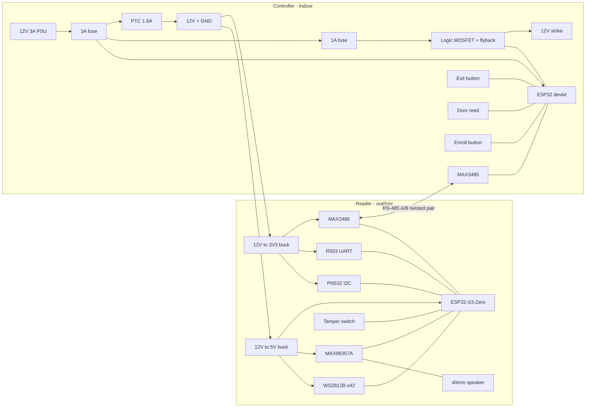

# MagicBand door reader – wiring

Two boards on one 4-core cable:

- **Reader** (outdoor ball head): ESP32-S3-Zero, PN532, R503, WS2812B halo, MAX98357A + speaker,
  MAX3485, tamper switch.
- **Controller** (indoor): ESP32 devkit, MAX3485, strike driver, REX / door / enroll inputs,
  12 V supply.

The relay/MOSFET and all decisions stay **indoors**. Firmware and pin
constants: [`../firmware/include/config.h`](../firmware/include/config.h).

This is the split build (`reader` / `reader_nofp` + `controller`). Two other cases have their
own sections below:
- a single reader that is the whole door, mounted on the secure side:
  [All-in-one reader](#all-in-one-reader-reader_aio-reader_aio_nofp)
- builds without the R503: [No fingerprint sensor](#no-fingerprint-sensor-_nofp-builds)

```
             OUTDOOR (ASA ball head)                         INDOOR (controller box)
  ┌─────────────────────────────────────────┐          ┌──────────────────────────────────────────┐
  │ PN532 ──I2C/IRQ──┐                      │          │                    ┌── REX button        │
  │ R503 ──UART/WAKE─┤                      │  4-core  │                    ├── door reed         │
  │ WS2812B ring ────┤ ESP32-S3-Zero        │  cable   │  ESP32 devkit ─────┼── enroll button     │
  │ MAX98357A+spkr ──┤        │             │ 12V ─────┼─ fuse ─ 12V PSU    └── MOSFET ─ strike   │
  │ tamper switch ───┘    MAX3485 ──── A/B ─┼──────────┼─ A/B ── MAX3485                          │
  │ 12V→5V buck, 12V→3V3 buck, TVS          │ GND ─────┼─ GND                                     │
  └─────────────────────────────────────────┘          └──────────────────────────────────────────┘
```



## Reader pins (Waveshare ESP32-S3-Zero)

Only GPIO1–16 from the side headers are used. These are left free:
- strapping pins 0 / 3 / 45 / 46
- USB pins 19 / 20
- GPIO21, the onboard RGB LED

Check the pin labels against your board's silkscreen. Clones exist with a different pinout. Every
pin is set in `config.h`.

| S3-Zero | Goes to | Notes |
|---|---|---|
| 5V | 5 V buck out | Feeds the board, LED strip and amp. **Not** the USB 5 V. Unplug the external 5 V, or use a diode, when flashing over USB-C |
| GND | Common ground | Star point at the buck output |
| GPIO1 | PN532 `SDA` | I2C. Module pull-ups go to its VCC = 3.3 V |
| GPIO2 | PN532 `SCL` | |
| GPIO4 | PN532 `IRQ` | Active low |
| GPIO5 | PN532 `RSTPD_N` | Only if your board has it (Adafruit 364). On Elechouse-style "V3" boards, leave it open: their `RSTO` is an *output* |
| GPIO6 | R503 `RX` | ESP TX → sensor RX, 57600 baud |
| GPIO7 | R503 `TX` | Sensor TX → ESP RX |
| GPIO8 | R503 `WAKEUP` | Touch output, high while a finger is on it (`FP_TOUCH_ACTIVE_HIGH`) |
| GPIO9 | MAX3485 `DI` | UART2 TX |
| GPIO10 | MAX3485 `RO` | UART2 RX (internal pull-up enabled) |
| GPIO11 | MAX3485 `DE` + `/RE` (bridged) | HIGH = transmit |
| GPIO12 | MAX98357A `BCLK` | I2S |
| GPIO13 | MAX98357A `LRC` | |
| GPIO14 | MAX98357A `DIN` | |
| GPIO15 | 330 Ω → WS2812B `DIN` | Through a 74AHCT125 (5 V powered) if the first LED flickers |
| GPIO16 | Tamper microswitch → GND | `INPUT_PULLUP`. The switch is **closed while the hatch is shut**, so a cut wire reads as tamper |

### Reader modules

| Module | Pin | Connect |
|---|---|---|
| PN532 (I2C mode) | VCC / GND | 3V3 rail / GND |
| | DIP / jumpers | I2C: `SEL0 = H (ON)`, `SEL1 = L (OFF)` |
| R503 (6-wire JST SH 1.0) | V+ (red) / GND (black) | 3V3 rail / GND. **3.3 V only** |
| | TX (yellow) / RX (green) | GPIO7 / GPIO6 |
| | WAKEUP (blue) | GPIO8 |
| | 3.3VT (white) | 3V3, the touch-detect supply. Must stay powered |
| | Wire colours | Vary between batches: go by the datasheet pin numbers |
| MAX98357A | VIN / GND | 5 V / GND |
| | GAIN | Open = 9 dB |
| | SD | Open = mono (L+R)/2 |
| | OUT+ / OUT− | 40 mm speaker. Never tie either output to GND |
| MAX3485 module (3.3 V) | VCC / GND | 3V3 / GND |
| | A / B | Cable pair. A to A, B to B |
| | Termination | Remove or open the module's 120 Ω (R7) at the reader end for runs under ~50 m (see Bus below) |
| WS2812B strip | +5V / GND | 5 V / GND, with 1000 µF / 10 V across them at the strip input |
| | DIN | via 330 Ω from GPIO15 |
| | Layout | First `LED_HALO_COUNT` (42) LEDs = halo. Further LEDs (`LED_MICKEY_COUNT`) = Mickey backlight |
| Tamper switch (Omron D2F-01L or similar) | COM / NO | GPIO16 / GND. Mount so the hatch presses it *closed* |

### Reader power entry (in the ball head)

```
cable 12V ─► SS54 (reverse polarity) ─┬─► 5 V buck (3 A) ─► 5V rail: S3-Zero 5V, LED strip, MAX98357A
                                      ├─► 3.3 V buck (0.5 A) ─► 3V3 rail: PN532, R503, MAX3485
                                      └─ SMBJ15A TVS to GND
cable A/B ── SM712 TVS (A, B to GND) ── MAX3485 A/B
cable GND ── GND
```

The PN532, R503 and MAX3485 get their own 3.3 V regulator, not the S3-Zero's LDO. Together they
pull up to ~0.3 A in bursts. Through the small onboard LDO that would be about 0.5 W of heat in
a closed ball.

## Controller pins (ESP32-WROOM-32 devkit, 30-pin)

| ESP32 | Goes to | Notes |
|---|---|---|
| VIN (5V) | 5 V buck out (12 V → 5 V) | |
| GND | Common ground | |
| GPIO16 | MAX3485 `RO` | UART2 RX |
| GPIO17 | MAX3485 `DI` | UART2 TX |
| GPIO4 | MAX3485 `DE` + `/RE` | HIGH = transmit |
| GPIO25 | Strike MOSFET gate (100 Ω series, 10 kΩ to GND), or relay module IN | HIGH = coil energised |
| GPIO32 | Exit (REX) button → GND | NO contact, `INPUT_PULLUP` |
| GPIO33 | Door reed → GND | Closed while the door is shut |
| GPIO27 | Enroll button → GND | Optional. Hold at power-up = Wi-Fi/MQTT portal |
| GPIO2 | Onboard LED | On = reader online |
| 3V3 | MAX3485 VCC | |

None of the strapping pins (0, 2*, 5, 12, 15) drive anything at boot. GPIO2 is only the LED.

Long input runs (REX, door): add 1 kΩ in series and 100 nF to GND at the ESP32 pin.

### Strike / lock output

Fail-secure 12 V DC electric strike: energise = unlocked (`STRIKE_ENERGIZE_TO_UNLOCK 1`).

```
 +12V ──[1 A fuse]──┬──────────────┐
                    │              │
              1N5819 (cathode)   STRIKE +
                    │              │
                    └───(anode)────┤ STRIKE −
                                   │
                                 Drain
 GPIO25 ──100 Ω──────────── Gate   IRLZ44N / AO3400 / D4184 module (logic-level)
            └─10 kΩ── GND          Source ── GND
```

- **The flyback diode is required.** Fit a 1N5819, or a 1N4007, across the coil, cathode to
  +12 V, right at the strike terminals. Without it, the switch-off spike kills the MOSFET and
  resets the ESP32.
  - Some strikes are AC/DC with a bridge rectifier inside. These still get the diode on the DC
    side.
  - Some have a built-in diode, which makes the polarity matter.
- **MOSFET.** It must be logic level. IRF520 modules do **not** switch fully at 3.3 V. The 10 kΩ
  pull-down keeps the strike off while the ESP32 boots.
- **Relay instead.** A 1-channel relay module with an optocoupler and a *high-level* trigger
  (jumper on H), coil from 5 V. Wire the strike to COM / NO. Active-low modules would pulse the
  strike at boot; avoid them or invert the logic in `writeStrike()`.
- **Maglock (fail-safe).**
  - Set `STRIKE_ENERGIZE_TO_UNLOCK 0`. The output is then ON = locked, and the firmware drops it
    to unlock.
  - Wire the maglock the same way, with the same flyback diode.
  - Codes usually require a PIR REX, a manual green break-glass release in series with the 12 V,
    and a fire-alarm relay. Check before you fit one.

## All-in-one reader (`reader_aio`, `reader_aio_nofp`)

One ESP32-S3-Zero is the whole door: reader, access engine, users, strike driver and Wi-Fi/MQTT.
There is no MAX3485, no controller and no 4-core cable.

**Fit it only on the secure side of the door.** The strike wire is inside or right next to the
reader, so anyone who can open the reader can open the door. If the reader faces the street or
a shared hallway, use the split build.

```
                         SECURE SIDE (indoor reader housing / wall box behind it)
  ┌─────────────────────────────────────────────────────────────────────────────┐
  │ PN532 ──I2C/IRQ──┐                                                          │
  │ R503 ──UART/WAKE─┤ (reader_aio only)             ┌── REX button  (GPIO10)   │
  │ WS2812B ring ────┤                               ├── door reed   (GPIO11)   │
  │ MAX98357A+spkr ──┤ ESP32-S3-Zero ── Wi-Fi ── HA  ├── enroll (GPIO17, opt.)  │
  │ tamper switch ───┘        │                      │                          │
  │                   GPIO9 ── MOSFET + flyback ── STRIKE (12 V)                │
  │ 12 V PSU ─ 2 A fuse ─ SS54 ─┬─ 5 V buck, 3V3 buck ─ 1 A fuse ─ strike branch│
  └─────────────────────────────────────────────────────────────────────────────┘
```

### All-in-one pins (Waveshare ESP32-S3-Zero)

The RS-485 pins 9/10/11 are free in this mode and drive the door instead. Everything else stays
where it is in the split reader. Still free: strapping 0/3/45/46, USB 19/20, GPIO21 (onboard
RGB LED), and in `reader_aio_nofp` also GPIO6–8.

| S3-Zero | Goes to | Notes |
|---|---|---|
| 5V / GND | 5 V buck out / star ground | As in the split reader |
| GPIO1 / GPIO2 | PN532 `SDA` / `SCL` | I2C |
| GPIO4 / GPIO5 | PN532 `IRQ` / `RSTPD_N` | |
| GPIO6 / GPIO7 / GPIO8 | R503 `RX` / `TX` / `WAKEUP` | `reader_aio` only. Unused in `reader_aio_nofp` |
| **GPIO9** | **Strike MOSFET gate** (100 Ω series, 10 kΩ to GND), or relay module `IN` | `PIN_STRIKE`. HIGH = coil energised. Not a strapping pin. It floats during reset, and the 10 kΩ keeps the strike off |
| **GPIO10** | **Exit (REX) button → GND** | `PIN_REX`. NO contact, `INPUT_PULLUP`. Held at power-up = Wi-Fi/MQTT portal |
| **GPIO11** | **Door reed → GND** | `PIN_DOOR`. Closed while the door is shut |
| GPIO12 / 13 / 14 | MAX98357A `BCLK` / `LRC` / `DIN` | I2S |
| GPIO15 | 330 Ω → WS2812B `DIN` | 42 LEDs, 144 LED/m strip, as in the split reader |
| GPIO16 | Tamper switch → GND | No switch in your housing? Set `HAS_TAMPER_SWITCH 0` (or bridge GPIO16 to GND). Otherwise it reads as "open" and every scan is denied |
| **GPIO17** | **Enroll button → GND** (optional) | `PIN_ENROLL`. Bottom header. Short press = enroll next band, 3 s = cancel, held at power-up = portal. Check that your board breaks out GPIO17 |

Long REX / door runs: add 1 kΩ in series and 100 nF to GND at the S3 pin, as on the controller.

### All-in-one power and strike wiring

The reader is fed with 12 V from a local PSU, so the strike can share the supply. Put the strike
driver (MOSFET or relay module, flyback diode, fuse) **inside the reader housing, or in a wall
box right behind it on the secure side**. Never put it on the far side of the door.

```
12 V PSU (2 A; 3 A for a maglock)
  + ──[2 A slow fuse]── SS54 ──┬──► 5 V buck (3 A) ──► 5V rail: S3-Zero 5V, LED strip, MAX98357A
                               ├──► 3.3 V buck (0.5 A) ──► 3V3 rail: PN532, R503
                               ├── SMBJ15A TVS to GND
                               └──[1 A fast fuse]──┬──────────────┐
                                                   │              │
                                         1N5819 (cathode)       STRIKE +
                                                   │              │
                                                   └───(anode)────┤ STRIKE −
                                                                  │
                                                                Drain
  GPIO9 ──100 Ω─────────────────────────────────────── Gate  IRLZ44N / AO3400 / D4184 module (logic-level)
           └─10 kΩ── GND                                       Source ── GND (to the PSU star point)
  − ── star GND
```

- **The flyback diode is required.** Fit a 1N5819 or 1N4007 across the coil, cathode to +12 V,
  right at the strike terminals. It is even more important here than on the controller: the
  switch-off spike happens a few cm from the PN532 and the ESP32.
- **Fuse the strike branch** (1 A fast, 2 A for big maglocks). A shorted coil then blows its own
  fuse instead of browning out the reader.
- **Ground.** Return the strike current straight to the PSU star point, not through the S3-Zero's
  GND pins. Keep the strike pair twisted and away from the PN532 antenna and the LED data line.
- **Relay instead of a MOSFET.** Use a 1-channel opto relay module with a *high-level* trigger,
  coil from the 5 V rail, and the strike on COM / NO. Active-low modules pulse the strike at boot.
- **Maglock:** `STRIKE_ENERGIZE_TO_UNLOCK 0`, same wiring. The fail-safe notes under the
  controller's "Strike / lock output" apply too: PIR REX, break-glass, fire-alarm interlock.
- **Mechanical exit.** The inside handle must always open the door without the electronics.

**Power budget (12 V).** Reader as in the table below: ~0.2 A typical, ~1.0 A peak with Wi-Fi on
(add ~0.1 A for the S3's radio). Add the strike, 0.25–0.5 A while pulsed. A **12 V 2 A** PSU is
enough for a strike. Use 3 A for a continuous maglock.

| Where | Part | Why |
|---|---|---|
| PSU + | 2 A slow fuse | Main protection |
| Strike branch | 1 A fast fuse (2 A maglock) | Shorted coil |
| 12 V input | SS54 + SMBJ15A | Reverse polarity, surges |

Not needed in the all-in-one: the MAX3485, the SM712, the 120 Ω / bias resistors, the cable PTC
and the controller box.

## No fingerprint sensor (`*_nofp` builds)

`reader_nofp` (split) and `reader_aio_nofp` (all-in-one) are band-only readers:
- **Leave the R503 out**, together with its 6-wire lead. GPIO6, 7 and 8 stay unconnected. No
  pull-ups are needed, because the firmware never touches them.
- **Cover the sensor hole** with the blank face disc (`face_disc_blank` in the CAD), or the
  R503 washer and a plug.
- **The 3.3 V rail** then feeds only the PN532 (and the MAX3485 in split mode). A 0.3 A buck is
  enough.
- **Split mode.** Cable, bus and controller wiring are unchanged. The controller learns from the
  reader's `HELLO` that there is no fingerprint sensor. Users that need a finger are then
  **denied**, not let in on the band alone, and HA raises "Fingerprint configuration problem".
  Set those users to `band_only`.

## Cable and bus

| | |
|---|---|
| Cable | Shielded twisted pair **2 × 2 × 0.5 mm²** (LiYCY-TP 2×2×0.5, or Belden 3106A-type), UV/outdoor-rated or in conduit |
| Pair 1 | RS-485 A / B (must be a twisted pair) |
| Pair 2 | +12 V / GND |
| Shield | GND at the **controller end only** |
| Alternative | Outdoor Cat6: one pair A/B, two pairs together for +12 V, one pair for GND |
| Connector | GX12-4 aviation or M12 4-pin A-coded **inline pair in the wall cavity / an outdoor junction box behind the bracket** (the bracket's 12 mm cable bore is too small for a panel socket). Pin 1 +12 V, 2 GND, 3 A, 4 B. Lets the head come off for service |
| Bus | 115200 8N1, two nodes, half duplex |

Bus termination and biasing:
- **Runs under ~50 m:** one 120 Ω across A–B at the controller only, plus fail-safe bias at the
  controller (680 Ω A → 3V3 and 680 Ω B → GND). This holds the idle bus at about 200 mV
  (MAX3485 receivers are not fail-safe on their own). Remove the 120 Ω on the reader module.
- **Longer runs:** 120 Ω at both ends, and bias resistors of 390 Ω.
- Without biasing the idle bus reads noise. The firmware copes, because frames are tag-checked
  and resynced, but it wastes the listen-before-talk window.

Voltage drop: 20 m of 0.5 mm² (0.036 Ω/m per core) is a 1.44 Ω loop. At the 1.0 A reader peak
that is 1.4 V, so the reader sees ~10.5 V. Its bucks are happy down to ~6.5 V.

## Power budget

LED current is the big one. A WS2812B draws up to **20 mA per colour channel** at 255:

- 42 LEDs × 60 mA full white = **2.5 A**. Too much for the reader supply and the cable, so the
  firmware caps it in two ways:
  1. `LED_MAX_BRIGHTNESS = 128` scales every pixel by 128/255. Full white is then
     42 × 60 mA × 0.502 = **1.27 A**.
  2. `LED_CURRENT_LIMIT_MA = 1200` estimates each frame's current
     (Σ channels × 20 mA × brightness) and scales the frame down further if it is over 1.2 A.
     So the strip **can never exceed ~1.2 A** (+42 mA quiescent), whatever `SET_CONFIG` says.
- Real states draw far less at the default brightness 96:
  - idle white breathing ≈ 0.25 A peak
  - granted green ≈ 0.39 A
  - denied blue/red ≈ 0.3 A

### Reader (5 V and 3.3 V rails)

| Load | Rail | Typical | Peak |
|---|---|---|---|
| ESP32-S3-Zero (Wi-Fi/BT off) | 5 V | 40 mA | 80 mA |
| PN532 (RF polling) | 3.3 V | 60 mA | 150 mA |
| R503 (ring LED on, scanning) | 3.3 V | 15 mA | 50 mA |
| MAX3485 (driving 120 Ω + bias) | 3.3 V | 1 mA | 30 mA |
| WS2812B × 42 (firmware-capped) | 5 V | 250 mA | 1 250 mA |
| MAX98357A + 40 mm speaker (chime) | 5 V | 5 mA | 600 mA |
| **Total at 5 V** (3.3 V via buck) | | **~0.45 A** | **~2.1 A** |
| **At 12 V** (≈ 88 % bucks) | | **~0.2 A / 2.5 W** | **~1.0 A / 12 W** |

The 5 V buck needs ≥ 3 A. The 3.3 V buck: 0.5 A.

### Controller (12 V)

| Load | Typical | Peak |
|---|---|---|
| ESP32 devkit via 5 V buck (Wi-Fi) | 0.06 A | 0.12 A |
| Reader feed | 0.2 A | 1.0 A |
| Electric strike while pulsed (typ. 12 V fail-secure) | 0 | 0.25–0.5 A |
| *(maglock instead: continuous)* | *0.5 A* | *0.5 A* |
| **Total** | **~0.3 A** | **~1.6 A** |

**PSU:** 12 V 3 A (Mean Well GST36A12 or similar). Add a battery-backed 12 V supply if the door
must work in a power cut.

### Fusing

| Where | Part | Why |
|---|---|---|
| PSU + output | 3.15 A slow blade/glass fuse | Main protection |
| Reader feed (+12 V into the cable) | PTC, 1.6 A hold (Bourns MF-R160) | A cable short outside resets itself and doesn't take the controller down |
| Strike branch | 1 A fast fuse (2 A for big maglocks) | Shorted coil |
| Reader input | SS54 series diode + SMBJ15A TVS | Reverse polarity, surges on the outdoor cable |
| RS-485 at both ends | SM712 TVS across A/B to GND | ESD / induced surges |

## BOM

Rough prices in USD, 2026.

### Reader

| Part | Example part number | Qty | ~Price |
|---|---|---|---|
| Waveshare ESP32-S3-Zero (ESP32-S3FH4R2) | ESP32-S3-Zero (or -M with headers) | 1 | $6 |
| PN532 NFC module, I2C | Elechouse PN532 NFC V3 / Adafruit 364 | 1 | $7 / $40 |
| Capacitive fingerprint sensor with RGB ring | Grow R503 | 1 | $14 |
| WS2812B strip **144 LED/m**, 5 V, 10 mm, IP65 glue-top (the CAD ring is 42 LEDs on a 292 mm strip; water can reach the light box through the speaker holes) | BTF-Lighting WS2812B 144/m IP65 | 0.3 m (42 LEDs) | $8 |
| I2S class-D amp | Adafruit 3006 (MAX98357A) or clone | 1 | $2–6 |
| 40 mm speaker, 4–8 Ω, ≥ 2 W, weather-resistant cone | e.g. PUI Audio AS04008 series | 1 | $4 |
| RS-485 transceiver module, 3.3 V | MAX3485 TTL↔RS485 module | 1 | $1.5 |
| 12 V → 5 V buck, 3 A | Pololu D24V30F5 (or MP1584 module, derated) | 1 | $17 / $1 |
| 12 V → 3.3 V buck, 0.5 A | Pololu D24V5F3 | 1 | $6 |
| Level shifter (optional) | 74AHCT125 | 1 | $0.6 |
| Tamper microswitch | Omron D2F-01L | 1 | $2 |
| TVS RS-485 / 12 V | SM712-02HTG, SMBJ15A | 1 + 1 | $1 |
| Reverse polarity Schottky | SS54 | 1 | $0.2 |
| 1000 µF 10 V, 330 Ω, 100 nF | – | 1 each | $0.5 |
| Inline connector (in the wall cavity) | GX12-4 or M12 A-coded 4-pin, cable plug + socket | 1 pair | $4 |
| **Reader subtotal** | | | **~$70** |

### Controller

| Part | Example part number | Qty | ~Price |
|---|---|---|---|
| ESP32 devkit, 30-pin | ESP32-WROOM-32 DevKitC clone | 1 | $6 |
| RS-485 module, 3.3 V | MAX3485 module | 1 | $1.5 |
| 12 V → 5 V buck | MP1584EN module | 1 | $1 |
| Logic-level MOSFET | IRLZ44N (+100 Ω, 10 kΩ) or D4184 module | 1 | $1.5 |
| Flyback diode | 1N5819 | 1 | $0.1 |
| Bias / termination | 120 Ω, 2 × 680 Ω | – | $0.1 |
| 12 V 3 A PSU | Mean Well GST36A12-P1J | 1 | $15 |
| Fuses + holders | 3.15 A slow, 1 A fast, MF-R160 PTC | 1 each | $3 |
| Exit button (NO) | any 12 mm NO pushbutton / REX plate | 1 | $5 |
| Door reed contact (closed when shut) | surface/recessed reed set | 1 | $4 |
| Enroll pushbutton | 6 mm tactile / panel button | 1 | $0.5 |
| Electric strike, fail-secure, 12 V DC | e.g. HES 5000C / generic 12 V fail-secure strike | 1 | $25–150 |
| Enclosure, terminal blocks | – | 1 | $8 |
| **Controller subtotal (excl. strike)** | | | **~$45** |

### Cable

| Part | Example | Qty | ~Price |
|---|---|---|---|
| 2 × 2 × 0.5 mm² shielded twisted pair, outdoor | LiYCY-TP 2×2×0.5 / Belden 3106A | run length | $1–2 / m |
